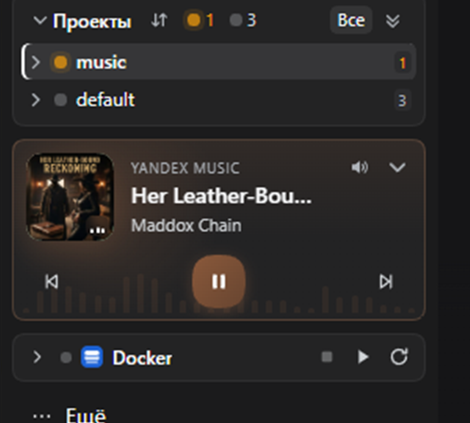

# Music widget

A compact widget in the DSH left-sidebar footer: every music source Windows
exposes through System Media Transport Controls (SMTC), in one mini player.
It does not open a separate page or add a main-menu item.

## Features

- All active media sessions on the PC: browsers, Spotify, Media Player, VLC and
  other apps that publish a track to Windows.
- A now-playing card with cover art, app, title, artist, progress and controls;
  other sources are listed below. Clicking a source promotes it to the card.
- No "Music" heading or icon in the expanded view; the collapse button with a
  down arrow sits in the top-right corner. Transport spans the full widget and
  has no "playing/paused" label — the button shows the state.
- An audio-reactive background equalizer driven by real system audio
  (WASAPI loopback RMS), not a synthetic animation; it settles on pause.
- When a cover exists, its accent color tints the frame, background, progress
  and buttons in both expanded and collapsed states. Without a cover, the
  generated cover palette is used.
- Play/pause via the round button; previous/next in the card. Unsupported
  actions are disabled.
- Seeking is a slider in place of the progress bar when the app exposes a
  duration and `TryChangePlaybackPosition`; otherwise the normal progress bar
  remains. There is no seek control in the collapsed strip.
- Volume is a button with a popover slider, available in expanded and collapsed
  views. It targets the active app's audio session when one can be identified,
  otherwise the output device's system volume. SMTC itself does not expose
  per-app volume.
- Track position comes from SMTC events and is only extrapolated for display
  between them; the UI does not poll.
- Collapses to a 31 px strip with artist/title, previous/play-pause/next and
  volume on the right. Text ellipsizes and does not overlap the buttons.
- No sorting, status filters or "All" button.

## Cover art

When a track changes, the Host tries, in order:

1. Apple iTunes Search (`itunes.apple.com/search`) — main and Russian storefront;
2. Deezer (`api.deezer.com/search`) — `cover_medium` from `*.dzcdn.net`;
3. MusicBrainz (`musicbrainz.org/ws/2`) and Cover Art Archive
   (`coverartarchive.org`) — official releases, one request per second.

Only the track title and artist leave the machine; no DSH, session or user data
is sent. Results are cached in memory and on disk
(`%LOCALAPPDATA%\dsh-music-cache`), and unchanged cover data is not resent in
every SSE snapshot.

The native SMTC thumbnail is not the primary source: Yandex Music returns an
empty thumbnail, while the external chain is predictable for more apps.

Set `DSH_MUSIC_COVER_ART=off` (or `0` / `false`) to disable external lookups
entirely; a generated cover is used instead. Provider order is controlled by
`DSH_MUSIC_COVER_PROVIDERS`, for example `apple,deezer` or `musicbrainz`.

`DSH_MUSIC_VOLUME=system` forces system volume instead of per-app volume.

## Data flow

The Host starts two long-lived processes:

- a PowerShell watcher for
  `Windows.Media.Control.GlobalSystemMediaTransportControlsSessionManager`,
  subscribed to manager and session events (`SessionsChanged`,
  `PlaybackInfoChanged`, `MediaPropertiesChanged`,
  `TimelinePropertiesChanged`), emitting a JSON snapshot only on change;
- an audio/transport helper for per-app volume via WASAPI, system fallback,
  play/pause/seek commands and loopback levels. Commands arrive over stdin
  instead of a new PowerShell process per click.

The browser receives snapshots and levels over the authenticated SSE route
`/api/dsh-music/stream`; transport commands go to `/api/dsh-music/action` and
volume to `/api/dsh-music/volume`. The UI has no data polling.

Both processes start with the first widget connection and stop a few seconds
after the last stream closes, so an idle page holds no extra processes.

## Stored settings

- `music-board:collapsed` — `'1'` / `'0'`.

The state survives a page reload.

## Limitations

- Windows only: WinRT SMTC and WASAPI are used. The widget is hidden elsewhere.
- Only apps that publish the current track to Windows media controls appear.
- Available commands depend on the app; unsupported buttons are disabled.
- Yandex Music currently exposes no duration or `canSeek`, so it has no seek
  slider. This is an app/SMTC limitation, not a widget bug.
- Volume target is chosen from the active audio sessions; with several loud
  apps the helper follows the loudest session.
- With no sessions or no integration, the widget does not render.

## Русский

См. [README.md](README.md).

## Checks

Locally: `pwsh ./scripts/check.ps1`. The GitHub Actions template is
[`docs/github-actions-check.yml`](docs/github-actions-check.yml); enabling it
requires a token with `workflow` scope.
