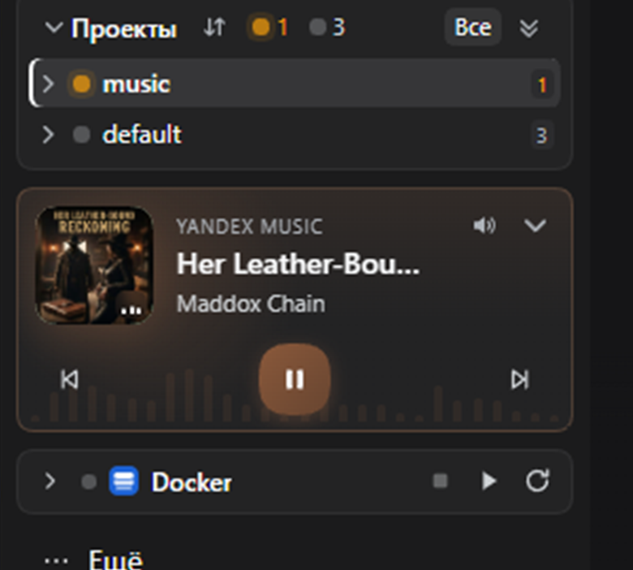

# Виджет музыки

Компактный виджет в подвале левой панели DSH: все источники музыки, которые
Windows видит через системные элементы управления мультимедиа (SMTC), в одном
мини-плеере. Виджет не открывает отдельную страницу и не добавляет пункт в
верхнее меню.

## Что показывает и умеет

- Все активные медиасессии компьютера: браузеры, Spotify, Media Player, VLC и
  другие приложения, публикующие трек в Windows.
- Главная карточка «сейчас играет» с обложкой, приложением, названием,
  исполнителем, прогрессом и управлением; остальные источники — компактным
  списком ниже. Клик по источнику в списке поднимает его в главную карточку.
- В развёрнутом виде нет заголовка «Музыка» и иконки; кнопка сворачивания со
  стрелкой вниз находится в правом верхнем углу. Транспорт занимает всю ширину
  виджета, без подписи «играет/пауза» — состояние видно по самой кнопке.
- На фоне развёрнутого виджета — аудио-реактивный эквалайзер. Он строится по
  реальному уровню системного аудиопотока (WASAPI loopback RMS), а не по
  синтетической анимации, и замирает на паузе.
- Если у трека есть обложка, её акцентный цвет подстраивает рамку, фон,
  progress и кнопки виджета — и в развёрнутом, и в свёрнутом виде. Без обложки
  используется цвет сгенерированной обложки.
- Пауза и продолжение круглой кнопкой; переключение трека — в главной карточке.
  Кнопки, которые приложение не поддерживает, отключены.
- Перемотка — ползунок на месте прогресса. Он появляется, если приложение
  отдаёт длительность и разрешает `TryChangePlaybackPosition`; иначе остаётся
  обычная полоса прогресса. В свёрнутом виде перемотки нет.
- Громкость — кнопка с поповером и ползунком; кнопка есть и в развёрнутом, и в
  свёрнутом виде. Если удаётся определить аудиосессию активного приложения,
  меняется громкость именно его; иначе — системная громкость устройства
  вывода. SMTC сам громкость приложения не отдаёт.
- Позиция трека приходит с событиями SMTC, а между ними плавно
  экстраполируется только для отображения — данные не опрашиваются.
- Свёртывание в полосу 31 px: остаются исполнитель и название трека, а справа —
  быстрые кнопки «предыдущий / пауза-плей / следующий» и громкость. Текст
  обрезается многоточием и не накладывается на кнопки.
- Сортировки, фильтров по статусам и кнопки «Все» нет.

## Обложки

Если у трека есть совпадение в одном из каталогов, виджет показывает настоящую
обложку. Когда трек меняется, хост-половина по очереди проверяет:

1. Apple iTunes Search (`itunes.apple.com/search`) — основной storefront и
   затем российский;
2. Deezer (`api.deezer.com/search`) — обложка `cover_medium` с `*.dzcdn.net`;
3. MusicBrainz (`musicbrainz.org/ws/2`) и Cover Art Archive
   (`coverartarchive.org`) — для официальных релизов, с лимитом один запрос в
   секунду.

В эти сервисы уходят только название трека и исполнитель; никакие данные DSH,
сессии или пользователя не отправляются. Результат кэшируется в памяти и на
диске (`%LOCALAPPDATA%\dsh-music-cache`), поэтому повторные снимки не ходят в
сеть. Неизменённая обложка не передаётся в каждом SSE-снимке.

Штатный SMTC-thumbnail не используется как основной источник: у Yandex Music он
приходит пустым, а внешняя цепочка даёт предсказуемый результат для большего
числа приложений.

Внешний поиск можно полностью отключить переменной окружения
`DSH_MUSIC_COVER_ART=off` (или `0` / `false`); тогда показывается сгенерированная
обложка. Порядок провайдеров задаётся `DSH_MUSIC_COVER_PROVIDERS`, например
`apple,deezer` или `musicbrainz`.

Режим громкости `DSH_MUSIC_VOLUME=system` заставляет использовать системную
громкость вместо громкости приложения.

## Откуда данные

Хост-половина плагина запускает два долгоживущих процесса:

- PowerShell-наблюдатель за
  `Windows.Media.Control.GlobalSystemMediaTransportControlsSessionManager`.
  Он подписан на события менеджера и каждой сессии (`SessionsChanged`,
  `PlaybackInfoChanged`, `MediaPropertiesChanged`,
  `TimelinePropertiesChanged`) и печатает новый JSON-снимок только при изменении,
  без опроса.
- аудио/транспортный helper: громкость приложения через WASAPI, системный
  fallback, команды play/pause/seek и уровни loopback для эквалайзера. Команды
  идут в него по stdin, а не через новый PowerShell-процесс на каждый клик.

Браузер получает снимки и уровни по аутентифицированному SSE-маршруту
`/api/dsh-music/stream`; команды управления уходят на
`/api/dsh-music/action`, громкость — на `/api/dsh-music/volume`. В интерфейсе
нет `setInterval` для обновления данных.

Оба процесса запускаются при первом подключении виджета и останавливаются через
несколько секунд после закрытия последнего потока, поэтому простаивающая
страница не держит лишние процессы.

## Хранение настроек

- `music-board:collapsed` — `'1'` / `'0'`.

Состояние переживает перезагрузку страницы.

## Ограничения

- Только Windows: используется WinRT SMTC и WASAPI. На других платформах
  виджет скрыт.
- Видны только приложения, которые публикуют текущий трек в системные элементы
  управления мультимедиа. Приложение без такой интеграции не появится.
- Набор доступных команд зависит от приложения: если оно не поддерживает
  «следующий трек», кнопка будет отключена.
- Yandex Music сейчас не отдаёт длительность и `canSeek`, поэтому для него нет
  ползунка перемотки. Это ограничение приложения/SMTC, а не виджета.
- Громкость Yandex Music определяется по активной аудиосессии; если активны
  несколько приложений, helper выбирает самую громкую сессию.
- Если данных нет (нет активных сессий или интеграция недоступна), виджет не
  рендерится и не занимает место.

## English

См. [README.en.md](README.en.md).

## Проверки

Локально: `pwsh ./scripts/check.ps1`. Шаблон GitHub Actions лежит в
[`docs/github-actions-check.yml`](docs/github-actions-check.yml); чтобы включить
его, нужен токен с правом `workflow`.
